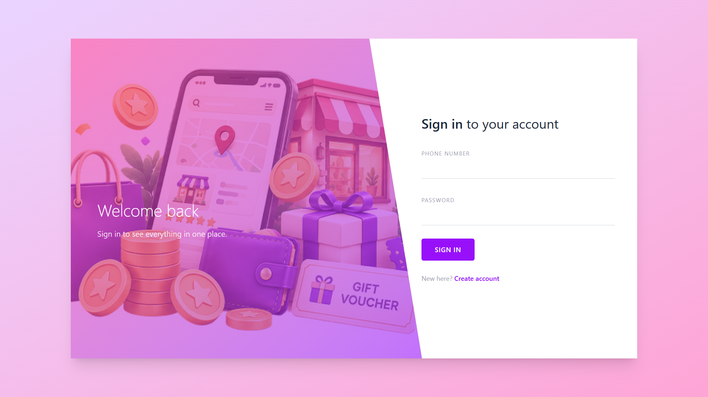
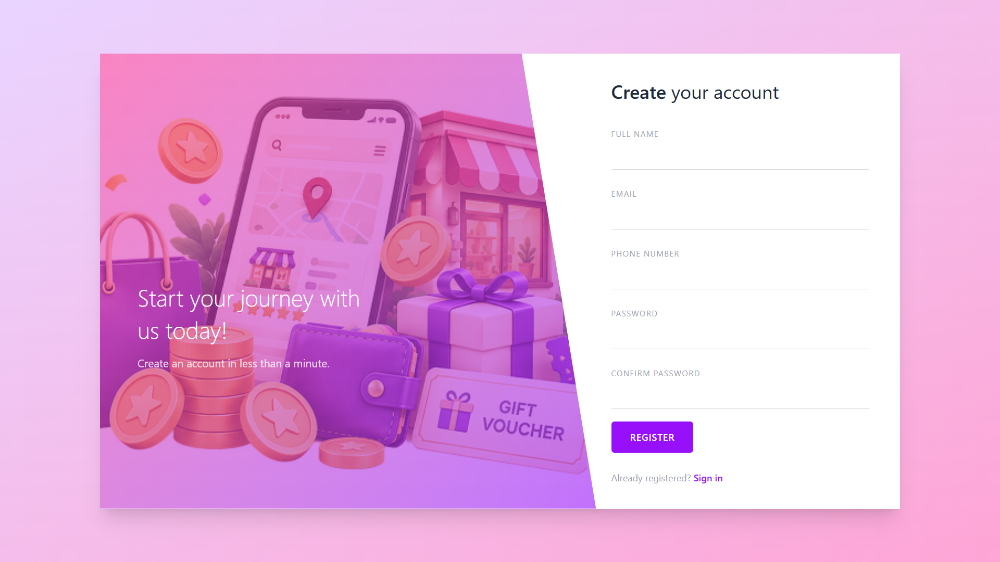
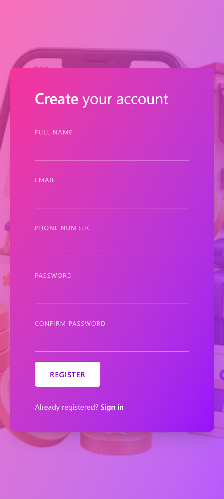
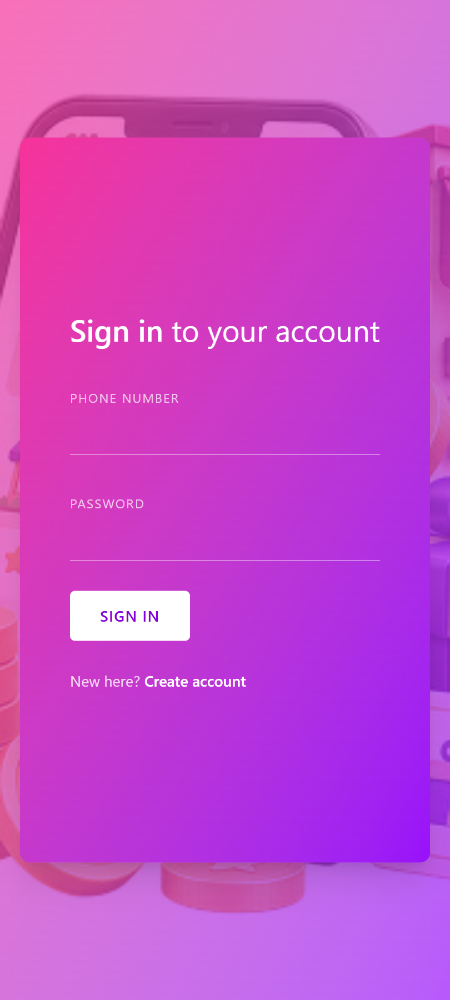

# Login and Register

This is a simple login and register project I made for an interview task.

A user registers with name, email, phone number and password. After that they can log in using the phone number and password. After login they go to a dashboard page.

## Screenshots

Login page



Register page



Dashboard


Mobile view




## What I used

- React (Vite) and Tailwind CSS for the frontend
- Node.js and Express for the backend
- MySQL with Sequelize
- bcrypt for hashing the password
- JWT for login token

## How to run

Backend:

1. Create the database in MySQL:

```
CREATE DATABASE setgo_db;
```

2. Make a `.env` file in the `setgo-backend` folder:

```
PORT=5000
DB_NAME=setgo_db
DB_USER=root
DB_PASS=your_password
DB_HOST=localhost
JWT_SECRET=any_long_text
```

3. Install and start:

```
cd setgo-backend
npm install
npm run dev
```

Frontend (keep the backend running in another terminal):

```
cd setgo-frontend
npm install
npm run dev
```

Then open http://localhost:5173

## What it does

- Register with validation (email, 10 digit phone, password min 8 characters)
- Login with phone and password
- Password is saved as a hash, not plain text
- Dashboard is protected, if you are not logged in it goes back to the login page
- Works on mobile and laptop

## API

- POST /api/auth/register
- POST /api/auth/login
- GET /api/auth/me (needs token)

Made by Sandra Shaji

```


```
